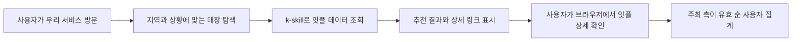

# BC카드 잇플 공모전 배경과 참가 준비

조사 기준일: 2026년 11월 8일 KST

BC카드의 **eat.pl 잇플 수익화 챌린지 공모전**은 잇플 스킬을 연결한 서비스를 운영하고, 그 서비스에서 잇플로 유입된 누적 순 사용자 실적으로 경쟁하는 공모전이다. 별도 작품 심사 없이 유입 순위로 수상자를 정한다. 준비의 핵심은 동작하는 서비스를 빨리 등록하고, 사용자에게 쓸모 있는 추천을 제공하며, 잇플 상세 페이지까지 정상적으로 연결하는 것이다. [공식 안내](https://edu.bccard.ai/contest), [참가 약관 1·6조 및 준수사항](https://edu.bccard.ai/static/contest/eatpl_challenge_application_form.pdf)

# 참가 조건과 일정

| 항목 | 확인된 내용 |
| --- | --- |
| 주최 | 비씨카드 |
| 자격 | 대한민국 국민, 개인 또는 4인 이내 팀 |
| 중복 참가 | 불가. 1인당 1개 서비스, 동일 성명·이메일의 중복 신청 불가 |
| 서비스 상태 | 실제 동작하는 서비스 필요. 도메인 확인 후 등록 완료 |
| 기존 서비스 | 기존 서비스에 잇플 연동을 추가해도 가능 |
| 전체 산정 기간 | 2026년 11월 1일부터 12월 13일까지 |
| 참가자별 산정 시작 | **등록 완료일부터**. 11월 1일까지 소급되는 것으로 이해하면 안 됨 |
| 등록 마감 | 12월 3일 목요일. 재원 소진 시 조기 마감 가능 |
| 측정 | 약관상 12월 14일부터 18일 사이 확정 측정. 메인 페이지에는 12월 14일로 요약 표기 |
| 확정 통지 | 12월 21일 이메일 |
| 이의제기 기한 | 12월 24일 |
| 지급 예정 | 12월 28일. 조기 종료 시 정산 일정은 약관의 별도 절차 적용 |
| 도메인 변경 | 12월 3일 전까지 1회 가능. 변경 전후 유입 합산 |

[신청 안내와 FAQ](https://edu.bccard.ai/static/contest/apply.html), [참가 약관 3·4·5조](https://edu.bccard.ai/static/contest/eatpl_challenge_application_form.pdf), [공식 일정](https://edu.bccard.ai/contest)

# 무엇을 세고 어떻게 보상하는가

**순 사용자**는 등록 도메인을 경유해 잇플로 들어온 사람 중 주최 측 분석 도구의 참여 요건을 충족한 활성 사용자를 전체 산정 기간 기준으로 중복 제거한 수다. 같은 사람이 같은 참가작을 통해 여러 번 방문해도 1명이다. 같은 사람이 서로 다른 참가작을 거치면 참가작마다 각각 산정한다. 페이지 조회 수, API 호출 수, 우리 서비스 가입자 수와는 다른 지표다. 일정 시간 체류 또는 페이지 이동 등의 요건이 있으나 정확한 시간 기준과 사용자 식별 방식은 공개 약관에 수치로 적혀 있지 않다. [참가 약관 2조](https://edu.bccard.ai/static/contest/eatpl_challenge_application_form.pdf)

| 보상 | 내용 |
| --- | --- |
| 기본 리워드 | 인정 순 사용자 1명당 10원, 세전 |
| 지급 하한 | 확정 지급액 1,000원 미만 미지급 |
| 참가작별 상한 | 없음. 전체 재원 한도 적용 |
| 전체 리워드 재원 | 1,000만원. 소진 시 신청·산정 조기 종료 |
| 순위 상금 | 1위 200만원, 2위 100만원, 3위 50만원 추가 |
| 수상 기준 | 최종 순 사용자 유입 순위만 반영, 별도 심사 없음 |
| 동점 처리 | 먼저 등록한 참가자 우선 |
| 팀 지급 | 대표자 1인 계좌로 지급, 팀 내 분배는 참가자가 결정 |

유효한 참가작이 부족하면 해당 순위 상금은 지급되지 않을 수 있다. 지급 안내는 건당 5만원 초과 시 22% 원천징수, 5만원 이하는 공제 없이 지급한다고 설명한다. 이는 이 공모전의 공지상 지급 조건이다. [지급 안내](https://edu.bccard.ai/static/contest/apply.html), [참가 약관 4·6·8조](https://edu.bccard.ai/static/contest/eatpl_challenge_application_form.pdf)

단순 계산상 기본 리워드는 100명에 1,000원, 1,000명에 1만원, 1만 명에 10만원이다. 따라서 기본 리워드만으로 사용자 획득 비용을 충당하려면 인정 사용자 1명당 비용이 10원보다 낮아야 한다. 개발비·운영비와 순위 상금은 이 계산에서 제외했다. **유료 광고보다 이미 접근 가능한 커뮤니티와 자연스러운 공유 동선을 우선 검토할 이유**가 있다.

# 서비스와 잇플이 연결되는 구조

사용자가 우리 서비스에서 지역·상황을 입력하면 잇플 스킬로 매장을 조회하고, 추천 결과에서 잇플 상세 페이지로 이동한다. 성과로 인정되는 것은 마지막 이동 이후 주최 측이 확인한 유효 순 사용자다.

잇플 자체도 지역·업종·동네맛집·가족외식·심야·회식 등의 탐색을 제공한다. 기획에서는 특정 사용자의 선택 과정을 더 쉽게 만들거나, 공유·합의 같은 추가 가치를 만드는 방향을 검토할 수 있다. [잇플 서비스](https://web.paybooc.ai/place/eatpl-home), [참가 안내의 연결 구조](https://edu.bccard.ai/static/contest/apply.html)

# 제공 데이터로 할 수 있는 일과 한계

잇플은 최근 1개월 BC카드 결제 데이터를 바탕으로 가맹점 단위 정보를 제공한다. 개별 고객 식별 정보는 포함되지 않는다. 매출 순위는 실제 매출액이나 고객 만족도 점수가 아니다. [API 정의서](https://eatpl.dothome.co.kr/api)

| 데이터 | 의미와 사용 시 주의점 |
| --- | --- |
| 전국·지역 매출 백분위 | 동일 업종 내 순위. 지역은 시·군·구 기준. 숫자가 낮을수록 상위이며 0.04% 같은 소수점을 보존 |
| 동네 맛집 여부 | 동네 고객 비율이 해당 시·군·구 평균보다 높은 매장 |
| 외국인 방문 여부 | 외국인 결제 이력이 있다는 뜻. 외국어 응대 가능 여부를 뜻하지 않음 |
| 회식 적합 여부 | 저녁 단체 결제 이력 기반. 좌석 수·예약 가능 여부는 별도 확인 필요 |
| 영업 예상 시간 | 최근 1개월 최초·최종 결제 승인 시각 기반. 공식 영업시간으로 단정할 수 없음 |
| 혼잡 요일·시간대 | 과거 집계 기반. 실시간 대기 시간과 다름 |
| 주요 방문 고객층 | 상위 3개 연령·성별 고객층 |
| 주소·업종·전화 | 전화번호가 부정확하거나 업종이 없는 경우 존재 |
| 상세 페이지 | 응답의 `merUrl` 그대로 사용 |
| 좌표 | TM128. 일반적인 WGS84 지도 좌표로 그대로 사용하면 안 됨 |

검색은 가맹점명·지역·업종의 텍스트 조건 기반이며, 주소 부분일치 검색이다. 반경 검색이 아니므로 “500m 이내” 같은 주장은 별도 위치 검증이 필요하다. 최대 100건이며 페이징은 없다. 메뉴 가격·알레르기·주차·예약·정확한 대기 시간은 확인한 검색 API 응답 항목에 없으므로 별도 근거 없이 생성하면 안 된다. [API 정의서](https://eatpl.dothome.co.kr/api)

공식 표기 요청은 **eat.pl 잇플 · BC카드 결제 데이터 기반**이다. k-skill 구현은 장소를 주소로 해석하고, 잇플 조회 결과에 카카오맵 평점을 보완하는 흐름을 설명한다. 카카오맵 평점은 별도 출처이며 잇플 결제 데이터와 구분해야 한다. [k-skill 구현 설명](https://github.com/NomaDamas/k-skill/blob/main/bccard-eatpl-search/instruction.md)

# 구현 전에 알아둘 연동 조건

공모전 안내는 개인 개발자가 `bccard-eatpl-search` 스킬을 통해 잇플 API를 이용하는 경로를 제시한다. 저장소에는 k-skill 프록시를 통한 검색 구현이 있다. 한편 BC카드 API 직접 연동 문서는 기관코드 발급, 호출 고정 IP 등록, 테스트·화면 검수 절차와 약 1주의 예상 연동 기간을 설명한다. **직접 연동 조건을 모든 공모전 참가자의 필수 준비로 단정하지 말고, 공모전용 k-skill 경로에 개인별 승인이 필요한지 확인해야 한다.** [신청 안내](https://edu.bccard.ai/static/contest/apply.html), [k-skill 구현 설명](https://github.com/NomaDamas/k-skill/blob/main/bccard-eatpl-search/instruction.md), [API 정의서](https://eatpl.dothome.co.kr/api)

| 구분 | 확인된 내용 |
| --- | --- |
| k-skill 검색 | 공개 구현은 GET 검색 프록시를 사용하며 지역·업종·가맹점명 조건을 지원 |
| 직접 API 검색 | `POST /v1/search`. 기관명·거래추적번호와 검색 조건 필요 |
| 키워드 검색 | API 정의서의 `GET /v1/search?keyword=...`는 현재 앱 내부용이며 파트너 연동 시 개방 가능. 기본 제공으로 가정하지 않음 |
| 호출 횟수 | 참가 FAQ는 별도 제한이 없다고 설명하나 비정상 호출은 제한 가능 |
| 데이터 보관 | 약관상 등록 서비스에 표시하는 용도로만 이용. 원본 별도 축적·제3자 제공·재판매 금지 |
| 종료 후 이용 | 주최 측이 정한 조건하에 계속 가능. 이용 조건 변경·제공 중단 가능 |

원본 응답의 단기 캐시도 어느 범위까지 허용되는지 운영 전에 확인할 필요가 있다. 이번 조사는 문서 확인이며 실제 검색 API 호출, 성능·CORS·응답 스키마 테스트는 하지 않았다. [참가 약관 9조의2](https://edu.bccard.ai/static/contest/eatpl_challenge_application_form.pdf)

# 집계가 누락되지 않도록 지킬 것

2026년 11월 8일 공식 신청 안내를 다시 확인했다. **검색 API 호출, 우리 지도 열람, 공유만으로는 집계되지 않는다.** 실제 사용자가 등록한 서비스 도메인에서 원본 `merUrl`로 이동하고 잇플의 참여 요건을 충족해야 한다. 현재 구현은 직접 링크, `rel="noopener"`, `referrerPolicy="strict-origin-when-cross-origin"`을 사용하며 사이트 응답 헤더에도 같은 정책을 지정한다. 일반적인 HTTPS 브라우저 이동에서는 우리 사이트의 origin을 `Referer`로 전달하도록 설정되어 있다. 주최 측은 정확한 내부 분석 도구와 식별 알고리즘을 공개하지 않았으므로 Referer 기반 매칭은 공식 도메인·유입 경로 요건에 근거한 기술적 해석이다. 이 설정 자체가 유효 사용자 반영을 증명하지는 않는다. 참가 등록 완료와 실제 사용자 방문 후 대시보드 반영은 아직 확인하지 않았다.

공유 페이지는 후보를 보여주는 실제 서비스 화면이며 잇플로 자동 이동시키지 않는다. 사용자가 그 화면에서 잇플 상세 링크를 직접 누르는 흐름이다. 인앱 브라우저와 설치된 PWA의 출처 전달 및 실제 집계는 별도 검증이 필요하다. 집계 확인을 위해 자동화 방문을 만들지 않는다. [공식 연결·집계 안내](https://edu.bccard.ai/static/contest/apply.html)

1. 최종 서비스의 정확한 호스트명을 등록한다. 신청 폼에는 `https://` 없이 서브도메인을 포함한 호스트명만 기재한다.
2. API가 반환한 `merUrl`을 바꾸지 않고 사용자의 웹 브라우저에서 직접 연다.
3. 잇플 링크에 UTM 등 추적 파라미터를 추가하지 않는다. 단축 URL이나 중간 페이지로 감싸지 않는다.
4. 서버에서 상세 URL을 호출하는 것은 사용자 방문으로 인정되지 않는다.
5. 인앱 브라우저·리다이렉트 등으로 유입 경로가 유실되면 집계되지 않는다.
6. 우리 서비스의 클릭 수와 잇플의 유효 순 사용자 수를 구분한다. 대시보드는 매일 오후 2시 갱신 예정이며 실시간이 아니다.
7. 자동화 방문 등 부정 유입은 금지된다. 실제 사용자 흐름으로 확인해야 한다.

브라우저의 referrer 정책과 외부 링크 속성은 개발 때 함께 점검할 항목이다. 특히 유입 출처를 없애는 설정이 없는지 확인하고, 최종 등록 도메인에서 정상 클릭 후 대시보드 반영까지 확인하는 것이 좋다. 이는 유입 경로 요건에서 도출한 구현 권고다. [연결 방법과 집계 제외 조건](https://edu.bccard.ai/static/contest/apply.html), [신청 폼](https://forms.gle/8kaCREhSgrUZTMbd8)

# 신청 서류와 권리

신청서 PDF를 내려받아 정보를 기입하고 동의 항목을 선택한 뒤 신청자 또는 팀 대표자가 자필 서명한다. 서명한 문서를 스캔하거나 촬영해 Google 신청 폼으로 제출한다. 폼은 파일 1개, 최대 10MB를 받는다. Google 계정 사용이 어려우면 안내된 이메일 접수 경로가 있다. 접수 후 등록 완료 회신이 와야 집계가 시작된다. [신청 안내](https://edu.bccard.ai/static/contest/apply.html), [신청 폼](https://forms.gle/8kaCREhSgrUZTMbd8)

준비 정보는 개인·팀 구분, 신청자 또는 팀명, 전체 참가자명, 이메일, 서비스 호스트명, 서비스명과 간단한 설명이다. PDF에는 첫 페이지와 마지막 페이지에 서명란이 있다. 개인정보 수집·이용은 필수 동의이며, 별도의 홍보 활용 동의는 선택 사항으로 거부해도 참가·심사상 불이익이 없다고 명시되어 있다. 참가작 권리는 참가자에게 귀속하되 주최 측에 공모전 홍보·결과 발표를 위한 명칭·화면·개요의 비독점적 이용권을 부여한다. [신청서 및 동의서](https://edu.bccard.ai/static/contest/eatpl_challenge_application_form.pdf)

기존 서비스는 참가 가능하지만, 제출 산출물이 타 공모전 수상작이거나 상당 부분 유사한 경우 등에 관한 제재 조항이 있으므로 기존 수상작을 재활용한다면 별도 확인이 필요하다. [신청서 준수사항](https://edu.bccard.ai/static/contest/eatpl_challenge_application_form.pdf)

# 현재 경쟁 현황

2026년 11월 8일 조회 시 대시보드는 참가 21팀, 누적 순 사용자 101명을 표시했다. **수치 자체의 기준일은 11월 5일까지 누적, 등록 표시는 11월 6일 15:36**이었다. 따라서 11월 8일 현재 실적이나 최종 경쟁 강도로 해석하면 안 된다. [공식 대시보드](https://edu.bccard.ai/contest)

| 순위 | 서비스 | 표시 순 사용자 |
| --- | --- | --- |
| 1 | 맛도리 | 32명 |
| 2 | 먹즈 | 20명 |
| 3 | 비주류 판독기 킥킥 | 12명 |
| 4 | 모임밥궁합 | 10명 |
| 5 | 망고 | 9명 |

대시보드에 점심 빙고, 오늘맛, 한동맛나 등 다양한 서비스명이 올라와 있다. 이름만으로 기능·품질·배포 전략을 판단하지 않는다. 각 서비스의 실제 기능 비교는 후속 기획 단계에서 진행할 수 있다.

# 기획에 적용할 판단과 다음 단계

다음은 공모전 규정에서 도출한 제안이다.

- **작은 기능으로 빨리 등록**: 등록 전 유입은 소급되지 않고 동점에도 등록 순서가 영향을 준다.
- **접근 가능한 사용자 집단부터 선택**: 특정 학교·직장·동네·모임처럼 실제 배포할 수 있는 집단이 있는지가 중요하다.
- **추천 이후의 행동까지 설계**: 사용자가 후보를 비교한 뒤 잇플에서 상세·영업 현황을 확인할 이유를 제공한다.
- **신규 도달과 공유를 고려**: 같은 사용자의 재방문은 해당 참가작의 누적 순 사용자 수를 늘리지 않는다. 모임 공유 등은 새 사용자가 들어올 경로가 될 수 있다.
- **데이터에 맞는 기능을 선택**: 회식 후보 비교, 동네 인기 매장 탐색 등은 제공 항목과 맞는다. 알레르기 안전 보장이나 확정 가격 비교는 추가 데이터가 필요하다.

권장 진행 순서는 타깃과 배포 경로 선택 → 작은 사용자 흐름 설계 → k-skill 연동 가능 여부 확인 → 실제 도메인에 동작 서비스 배포 → 서류 제출 및 등록 완료 확인 → 정상 유입 집계 확인 → 사용성·공유 기능 개선이다.

주최 측에 확인할 질문은 아래와 같다. 아직 문의를 발송하지 않았다.

1. 공모전용 k-skill 프록시 사용자는 개별 제휴 승인·기관코드·IP 등록이 필요한가?
2. 순 사용자 참여 요건과 집계 지연 범위는 무엇이며 모바일·인앱 브라우저에서 권장하는 연결 방식이 있는가?
3. 원본 데이터 축적 금지 조건하에서 허용되는 단기 캐시의 범위와 만료 시간은 무엇인가?
4. 상위 3팀 추가 상금은 리워드 재원 1,000만원과 별도인가? 상금·리워드의 지급 하한과 합산 정산은 어떻게 적용되는가?

공모전 문의: [bcaimerchant@bccard.com](mailto:bcaimerchant@bccard.com)

공식 조건은 [공모전 안내](https://edu.bccard.ai/contest), [신청 안내](https://edu.bccard.ai/static/contest/apply.html), [신청서 및 약관](https://edu.bccard.ai/static/contest/eatpl_challenge_application_form.pdf)을 함께 확인한다. 기술 참고 자료는 [API 정의서](https://eatpl.dothome.co.kr/api), [k-skill 저장소](https://github.com/NomaDamas/k-skill/tree/main/bccard-eatpl-search)다.
